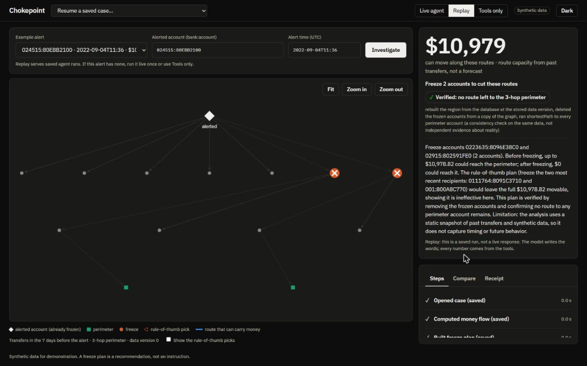
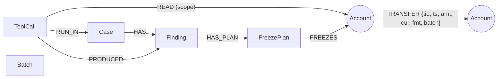
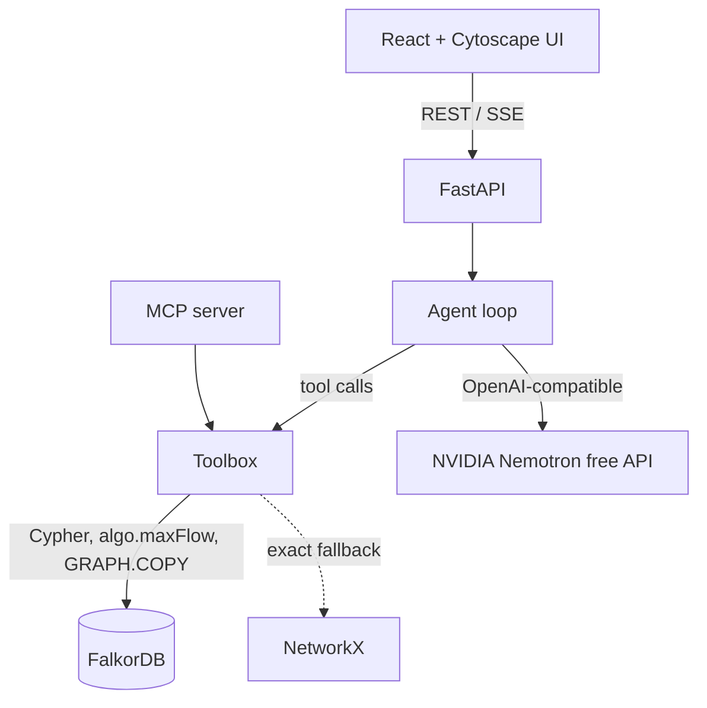

# Chokepoint

**An investigation agent that finds the accounts to freeze so stolen money cannot keep moving, proves no route is left, and keeps a receipt for every answer.**

Built for [Graph Hacks: Context for AI Agents](https://www.wemakedevs.org/hackathons/falkordb) (WeMakeDevs x FalkorDB, Oct 15-18 2026). **Track 1: Agents that act on connected data.** Solo entry.

> Live demo: _to be added at deployment_ · Demo video: _to be added_ · Blog post: _to be added_

 

## The problem

When a scam victim's money lands in a mule account it is usually moved on within minutes, through chains of other accounts. An investigator who gets the alert has to decide, fast: where can the money still go, which few accounts do we freeze to stop it, and what does that cost innocent customers? Looking at one account at a time does not answer that. The answer depends on how accounts connect.

## What it does

Given an alerted account and an alert time, the agent:

1. **Opens a case**: builds the region of accounts the money could have reached in the days before the alert (hop-limited, from the transfer graph in FalkorDB).
2. **Computes the flow**: an upper bound on how much money could still move to the *perimeter* (accounts a fixed number of hops away, treated as out of reach).
3. **Builds a freeze plan**: the cheapest set of accounts whose removal cuts every route to the perimeter (a minimum-cost vertex cut), next to a same-size **rule-of-thumb plan** (freeze the accounts the alerted account paid most recently) for comparison.
4. **Verifies the plan** on a copy of the graph with the frozen accounts deleted: is any route left?
5. **Stores every result as a node with a receipt** (tool run, parameters, data version, solver, accounts read), so a case can be resumed in a later session and any answer can be traced back.

The alerted account is treated as already frozen (its money has moved on). The language model chooses tools and their arguments and writes a short summary; **every number on screen comes from a tool, never from the model**. If there is no route, it widens the window or the perimeter (at most twice) and says so; if a plan is too large to act on it refuses to recommend it.



## Results (held-out evaluation, synthetic data)

Offline evaluation on 155 laundering patterns from the IBM synthetic AML data, split 50/50 by pattern into a tuning half and a **held-out half that was run once**. Full protocol and numbers: [`docs/pilot-protocol.md`](docs/pilot-protocol.md), [`docs/pilot-results.md`](docs/pilot-results.md).

- **It does not block more laundering than the best simple rule of thumb.** At equal budget, Chokepoint blocks about the same share of the money that had already escaped as "freeze the accounts the alerted account paid most recently" (difference -0.002, 95% interval [-0.09, +0.08], clustered by pattern). It beats top-degree (+0.049 [+0.013, +0.088]), top-throughput (+0.166) and most-frequent recipients (+0.137).
- **Its frozen accounts are more precise**: +0.19 [+0.07, +0.32] more of them are accounts that took part in the laundering (a secondary metric; reported because the primary one tied).
- **It touches more everyday transfers than the rule of thumb** (+4.8 per case) but fewer than top-degree (-4.6).
- **Only 50% of the rule of thumb's picks lie on a route to the perimeter**; 61% of its innocent picks have no route at all. Every account Chokepoint freezes is on a route by construction, and the plan is **verified** to cut all of them.
- **To guarantee that no route is left, the simple rules need more accounts**: the most-recent-recipients rule needs more than the minimum cut in 64% of cases (median 3 accounts against 1); highest throughput in 70%; highest degree in 47% ([`docs/guarantee-and-latency.md`](docs/guarantee-and-latency.md)). The tools take a median of 0.27 s from alert to verified plan.
- Caveats: synthetic data; cases are selected from labelled laundering patterns (labels are never used by the planner); static view of past transfers (no timing); counts, not amounts; 40-43 usable cases per alert time.

### The agent itself

Live-agent evaluation on 120 cases from both halves of the patterns (details, and what the first runs found, in [`docs/agent-eval.md`](docs/agent-eval.md)):

- **120/120 completed** and **120/120 followed a valid workflow** (open the case first; verify before recommending).
- **81/81 actionable plans were verified** before being recommended; **12/12 plans needing more than 25 accounts were declined**; **0** recommendations without verification and **0** where no route to the perimeter exists; at most two widenings.
- **119/120 narratives stated only figures and account ids that a tool returned.** The one miss mis-transcribed a dollar amount; the interface now runs this check on every answer and flags such a figure to the user. Numbers on the cards come only from tools.
- The first run was worse (8 runs looped on high-volume hub accounts until the step limit) and exposed a half-written-result bug; both were fixed and tested. Those fixes were developed on the first 60 cases, so the second 60 (unseen by them) are the fairer estimate; they are nearly identical.

### Late data and a second agent

- **Late or back-dated transfers** (`refresh_case`): each saved finding is linked to the accounts its tool run read, so one traversal finds the findings a new transfer touches; only those are re-run, old ones are marked superseded and linked to their replacements, the rest are carried forward. On 40 held-out cases with four kinds of late batch, the refreshed answers equalled a full recomputation in **40/40**, the scope rule **missed no change**, and it re-ran 50% of the findings (savings come from late data that does not touch the case; touched cases re-run everything, half of which was unchanged). [`docs/ripple-eval.md`](docs/ripple-eval.md)
- **An auditor agent** shares state with the investigator only through the graph: it reads the stored case and plan, runs deterministic checks, and records a verdict as a finding that appears when the case is resumed. Code refuses an "agree" while a blocking check (verified, current, actionable, no routes left) fails.

## Why FalkorDB

| Role | How the graph is used |
|---|---|
| Storage and traversal | 4.49 million transfers over 422,734 accounts as `(:Account)-[:TRANSFER]->(:Account)`; per-hop frontier queries with indexes on `Account.id` and `TRANSFER.ts` |
| Algorithm | `algo.maxFlow` on a node-split network, used as a **certified first pass** (see below) |
| Verification | `GRAPH.COPY`, `DELETE` of the frozen accounts, then `shortestPath` to every perimeter account |
| Memory and provenance | `Case`, `ToolCall`, `Finding`, `FreezePlan` nodes linked to the accounts they read; `resume_case` and `explain_finding` are traversals |
| Isolation | labels live in a separate `eval_ibm` graph that no planning tool can read; scratch graphs `case_<id>_run_<n>` are disposable |

Remove FalkorDB and there is no data, no region, no plan, no verification and no memory.

### A FalkorDB finding

`algo.maxFlow` (v4.22.0 and 6.0.2) returns a **non-maximal flow that violates conservation on about 17% of random node-split networks**. An 11-edge reproduction, the measurements and a draft bug report are in [`docs/falkordb-maxflow-findings.md`](docs/falkordb-maxflow-findings.md) and [`docs/falkordb-bug-report-draft.md`](docs/falkordb-bug-report-draft.md). So a FalkorDB result is accepted only with a certificate (the flow is feasible and no sink is reachable in the residual graph, which proves optimality); otherwise the same network is solved exactly in NetworkX. Tests: 120 random networks, **zero false accepts**, final plans equal the NetworkX optimum on all of them, and a strict `xfail` on the minimal repro so a FalkorDB fix is noticed.

## Graph data model



- `tenant_ibm`: `Account {id}` (`"bank:account"`); `TRANSFER {tid, ts (epoch minutes), amt (integer cents of the paying currency), cur, fmt, batch}`; self-transfers dropped. `Case {id, origin, alert_ts, window_min, hops, data_version}`; `ToolCall {id, tool, params, data_version, solver, ran_at, duration_ms}`; `Finding {id, kind, key, value, status, version, data_version}`; `FreezePlan {id, cost, lambda, size, hops, verified}`; `Batch {id}` (data versions).
- `eval_ibm`: `TransferLabel {tid, pattern, laundering}`, read only by the evaluation code.
- Scratch graphs `case_<id>_run_<n>` and `..._v`: the region as `(:A)-[:T]->(:A)`, built per verification and deleted after.
- Case, plan and finding ids are derived from their inputs, so every tool is idempotent and a saved agent run can be replayed.

## Queries and algorithms the product depends on

All Cypher is a fixed, parameterised template in code (`src/chokepoint/`); the model never writes Cypher.

**Region extraction** (`casegraph.py`), once per hop, with a row-count assertion because the server silently truncates at `RESULTSET_SIZE`:
```cypher
MATCH (a:Account)-[t:TRANSFER]->(b:Account)
WHERE a.id IN $frontier AND t.ts >= $t_from AND t.ts <= $t_to AND t.batch <= $data_version
RETURN a.id AS s, b.id AS d, t.cur AS cur, sum(t.amt) AS amt, count(t) AS n, max(t.ts) AS last
```

**Baseline activity** (the label-free part of the freeze cost):
```cypher
MATCH (a:Account)-[t:TRANSFER]-() WHERE a.id IN $ids AND t.ts <= $t_to AND t.batch <= $dv
RETURN a.id AS id, count(t) AS n
```

**Max flow** (`algo/cut.py`), on a scratch graph with one capacity property; multi-edges are rejected by FalkorDB so transfers are aggregated per pair first:
```cypher
MATCH (s:N {id: $source}) MATCH (t:N) WHERE t.id IN $sinks
WITH s, collect(t) AS ts
CALL algo.maxFlow({sourceNodes: [s], targetNodes: ts, relationshipTypes: ['E'], capacityProperty: 'cap', nodeLabels: ['N']})
YIELD edges, edgeFlows, maxFlow
RETURN maxFlow, [e IN edges | [startNode(e).id, endNode(e).id]] AS ends, edgeFlows
```

**Minimum-cost vertex cut** by node splitting: each account becomes `v:in -> v:out` with capacity equal to its freeze cost; transfers become infinite-capacity edges; the alerted account and the perimeter cannot be frozen. The cut is read from the flow and residual reachability. Cost: `100 + round(lambda * 100 * log1p(base) / log1p(max_base))`, where `base` is pre-alert activity outside the region (never laundering labels). Details: [`src/chokepoint/algo/cut.py`](src/chokepoint/algo/cut.py).

**Verification** (`toolbox.py`): build the region as a scratch graph, `GRAPH.COPY` it, delete the frozen accounts from the copy, then
```cypher
MATCH (s:A {id: $o}) MATCH (t:A) WHERE t.id IN $perim
WITH t, shortestPath((s)-[:T*]->(t)) AS p RETURN t.id AS id, p IS NOT NULL AS reachable
```
This is a consistency check on the same data, not independent evidence about reality.

**Provenance and memory**: one `CREATE` per finding linking `Case`, `ToolCall`, `Finding` and `READ` edges to the accounts read; `resume_case` and `explain_finding` traverse them (see `toolbox.py`).

## Architecture



- **Agent**: a manual tool loop with the decision rules in the system prompt; recorded runs can be replayed (the UI labels them). Model: `nvidia/nemotron-3-super-120b-a12b` through NVIDIA's free OpenAI-compatible endpoint, behind a provider-neutral client with an app-side rate limit.
- **Modes**: live agent, replay of saved runs, tools only (no model).
- **MCP**: `python -m chokepoint.mcp_server` exposes the same nine tools (open_case, flow, freeze_plan, verify_plan, resume_case, refresh_case, explain_finding, audit_checks, submit_audit) over stdio, or token-protected HTTP with `--http`.

## Run it

Needs Docker, Python 3.12 with [uv](https://docs.astral.sh/uv/), and Node 22.

```bash
# 1. FalkorDB (pinned image, localhost only, AOF on)
cp .env.example .env            # set FALKORDB_PASSWORD (and NVIDIA_API_KEY for the live agent)
docker compose up -d falkordb

# 2. Data: downloads the IBM synthetic data (91 MB, checksum verified) and loads FalkorDB (~2 min, ~2 GiB)
uv sync
uv run python scripts/download_data.py
uv run python scripts/load_ibm.py

# 3. App
uv run uvicorn chokepoint.api:app --port 8000        # API
cd web && npm ci && npm run dev                      # UI at http://localhost:5173
```

Everything in containers: `docker compose --profile seed run --rm seed` then `docker compose --profile app up -d --build` (UI and API on `127.0.0.1:8080`; put a TLS reverse proxy in front for a public host).

**Tests**: `uv run pytest` (needs FalkorDB and the loaded data; 45 tests plus one strict `xfail` that tracks the FalkorDB bug, about a minute). Some tests edit the demo data (simulated late batches) and reset it afterwards.

**Reproduce the numbers** (each script's docstring has the protocol; results are written to `scratch/`):

| Claim | Command | Write-up |
|---|---|---|
| plan quality vs simple rules, held-out | `scripts/g7_pilot2.py --split test --frac 0.5`, then `scripts/g7_report2.py` | `docs/pilot-results.md` |
| accounts needed to guarantee a cut; latency | `scripts/eval_budget_latency.py` | `docs/guarantee-and-latency.md` |
| the live agent | `scripts/eval_agent.py --split test` (and `--split dev`) | `docs/agent-eval.md` |
| late data (ripple) | `scripts/eval_ripple.py --limit 40` | `docs/ripple-eval.md` |
| FalkorDB `algo.maxFlow` defect | `tests/test_cut_oracle.py` | `docs/falkordb-maxflow-findings.md` |

**Deploy**: [`docs/deploy.md`](docs/deploy.md). **Demo script**: [`docs/demo-script.md`](docs/demo-script.md).

## Data

IBM "HI-Small" synthetic transactions (Altman et al., NeurIPS 2023 Datasets and Benchmarks, [arXiv:2306.16424](https://arxiv.org/abs/2306.16424)), released as synthetic data under CDLA-Sharing-1.0. Mirror: `eexzzm/IBM-Transactions-for-Anti-Money-Laundering-HI-Small-Trans` on Hugging Face. The data is not in this repository. No real people or accounts are involved.

## Limitations

- Synthetic data; results do not predict real-world performance. A freeze plan is a recommendation, not an instruction.
- The planner sees past transfers only and treats flow as static (it ignores the order of transfers); about 55-60% of evaluation cases block nothing, for every method.
- Cases are selected using laundering labels (as a detector with perfect recall would); labels are never used by the planner and only score the evaluation.
- "Perimeter K hops away" is a modelling choice; the data has no natural cash-out signal.
- The free model can be rate-limited or slow; replay and tools-only modes exist for that reason.

## AI assistance disclosure

I used an AI coding assistant (Claude Code) for research, planning, code, tests and documentation, and I review everything it produces. A daily log is in [`docs/ai-work-log.md`](docs/ai-work-log.md). The agent inside the product uses a free NVIDIA Nemotron model; numbers shown to users come from deterministic tools. **Pre-event preparation (Oct 14, before the event opened):** research and planning notes (ideas, a graph model sketch, evaluation design, checklists) containing no application code, and a short familiarisation with FalkorDB's documentation examples in a throwaway container (command line only, nothing saved). All code, data pipeline, tooling, interface, deployment and evaluation work in this repository was done after the event opened on Oct 15, 00:01 IST.

## Licence

MIT. FalkorDB is used unmodified as a backend service (SSPLv1). Third-party licences: falkordb-py, NetworkX (BSD-3), FastAPI, FastMCP, Cytoscape.js (MIT), IBM Plex fonts (SIL OFL 1.1), IBM data (CDLA-Sharing-1.0).
