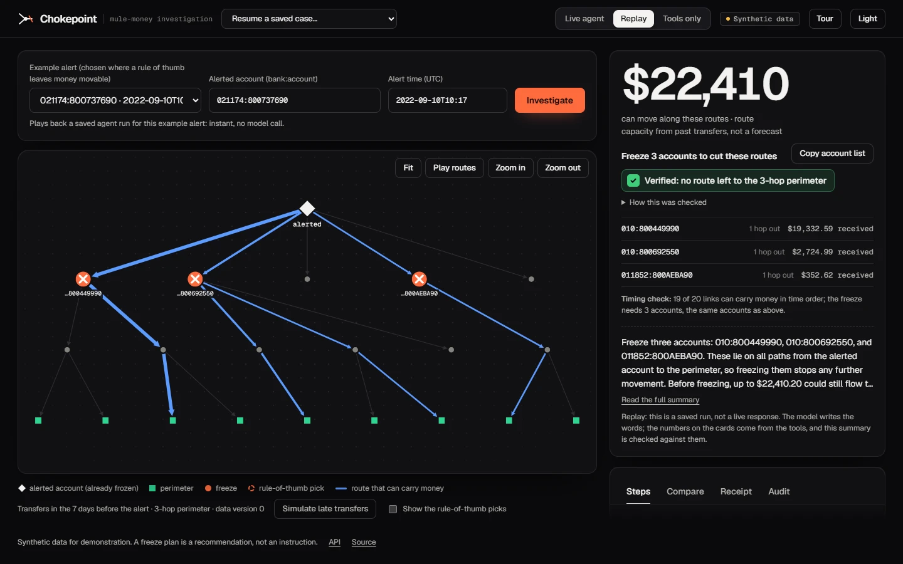
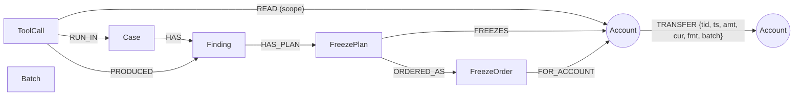
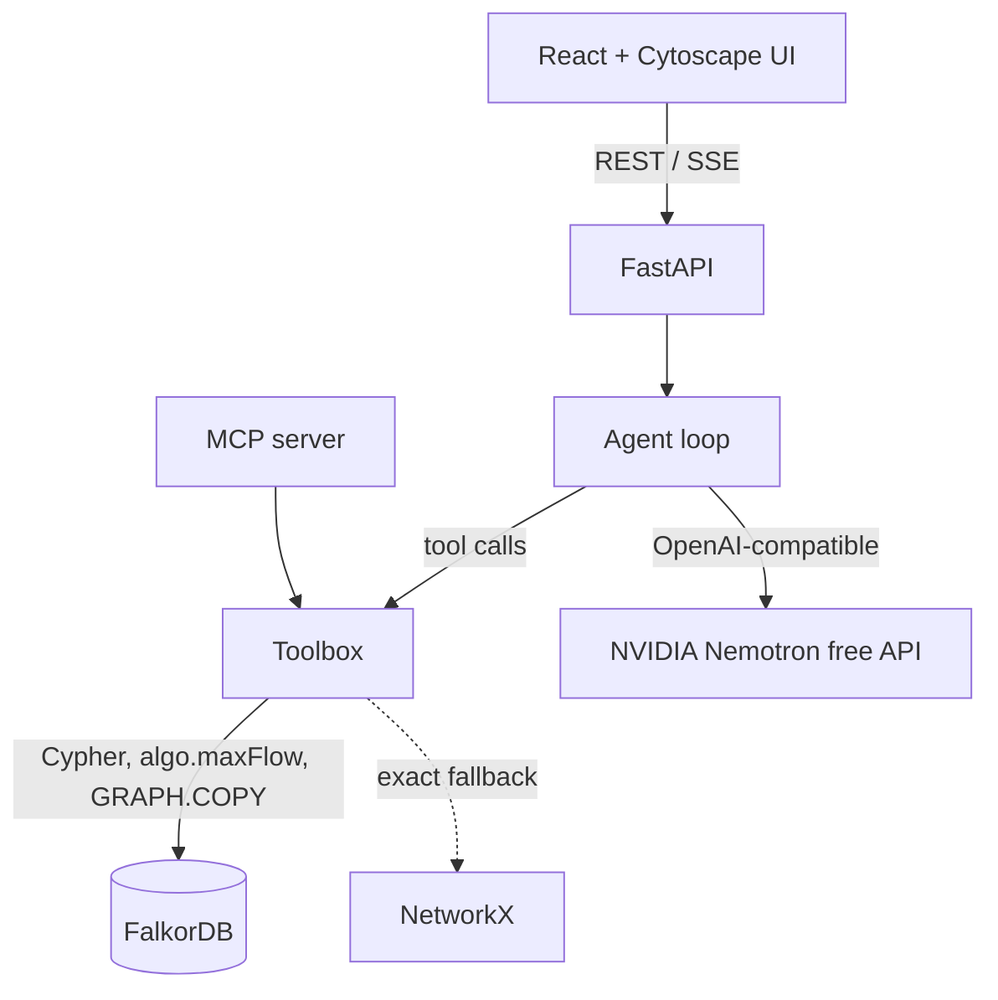

# Chokepoint: which mule accounts do you freeze to stop the money?

**An investigation agent on FalkorDB that works out the few accounts whose freeze cuts every route stolen money could have taken, checks on a copy of the graph that no route is left in the recorded transfers, lets a person approve the plan, and keeps a receipt for every answer.**

Built for [Graph Hacks: Context for AI Agents](https://www.wemakedevs.org/hackathons/falkordb) (WeMakeDevs x FalkorDB, Oct 15-18 2026). **Track 1: Agents that act on connected data.** Solo entry.

> Live demo: **<https://chokepoint-uou2.onrender.com/>** (a free host: the first load after idle can take about a minute) · Demo video: _to be added_ · Blog post: _to be added_

[](https://github.com/Hackmaass/Chokepoint/actions/workflows/ci.yml)   



### For judges in a hurry

- **Live:** <https://chokepoint-uou2.onrender.com/> (landing page; **Open the demo** for the app; the 8 example alerts replay saved runs and run the tools).
- **60-second path:** [`docs/for-judges.md`](docs/for-judges.md): what is real, what is not, a removal test, and where each claim can be checked.
- **Every measured number in one command**, no key and no model: `docker exec chokepoint-api python scripts/judge_check.py` (or `uv run python scripts/judge_check.py`). Measured lines can fail; the held-out figures are printed as RECORDED, never as PASS.
- **Run it in two minutes, no dataset download:** `docker build -f Dockerfile.hosted -t chokepoint-hosted . && docker run -p 7860:7860 chokepoint-hosted`, then open <http://localhost:7860/>. It holds a 4,453-transfer slice with the neighbourhoods of the 8 example alerts (about 100 MB of memory); any other account needs the full stack below.
- **The pages:** `/` is a short landing page; `#/app` is the app, with a one-minute guided tour (the **Tour** button). The demo replays a saved agent run, so it needs no model key.

## The problem

When a scam victim's money lands in a mule account it is usually moved on within minutes, through chains of other accounts. An investigator who gets the alert has to decide, fast: where can the money still go, which few accounts do we freeze to stop it, and what does that cost innocent customers? Looking at one account at a time does not answer that. The answer depends on how accounts connect.

## What it does

Given an alerted account and an alert time, the agent:

1. **Opens a case**: builds the region of accounts the money could have reached in the days before the alert (hop-limited, from the transfer graph in FalkorDB).
2. **Computes the flow**: an upper bound on how much money could still move to the *perimeter* (accounts a fixed number of hops away, treated as out of reach).
3. **Builds a freeze plan**: the cheapest set of accounts whose removal cuts every route to the perimeter (a minimum-cost vertex cut), next to a same-size **rule-of-thumb plan** (freeze the accounts the alerted account paid most recently) for comparison.
4. **Verifies the plan** on a copy of the graph with the frozen accounts deleted: is any route left? A second check re-expands the transfers from the source graph with the frozen accounts excluded and must agree.
5. **Stores every result as a node with a receipt** (tool run, parameters, data version, solver, accounts read), so a case can be resumed in a later session and any answer can be traced back.
6. **A person approves.** The app lists the checks that apply and a named person can record a freeze order, tied to the plan, its accounts, the data version and the check by a hash. It is refused for an unchecked plan, once newer transfers exist, or if the two checks disagree. It is an HTTP endpoint, not a tool, and not in MCP, so the model cannot call it; no bank is called.

Two more things sit on the card, both honest about their limits. A **timing check** keeps only routes whose transfers happen in time order (on the 8 examples, 3 have no time-ordered route and 2 need fewer accounts; it was added after the held-out run, so no claim beyond those 8; the verified plan itself is still static). **Gentler plans** offer other plans at a higher weight on everyday activity: on 2 of the 8 examples one exists (3 accounts and 21 everyday transfers become 5 and 6), each is checked before it can be approved, and it is a trade-off shown, not a claim that more accounts is better.

The alerted account is treated as already frozen (its money has moved on). The language model chooses tools and their arguments and writes a short summary; **the numbers on the cards and tables come only from tools; the model's short summary is checked against the tool results, and any figure no tool returned is flagged to the user**. If there is no route, it widens the window or the perimeter (at most twice) and says so; if a plan is too large to act on it refuses to recommend it.

> **About the example alerts.** The eight alerts in the picker are drawn from the synthetic laundering patterns and were kept only where the rule-of-thumb plan leaves at least a quarter of the movable money (so the comparison is visible). They are not typical: the held-out numbers below are. Case selection uses laundering labels; the planner never sees them.

## Results (held-out evaluation, synthetic data)

Offline evaluation on 155 laundering patterns from the IBM synthetic AML data, split 50/50 by pattern into a tuning half and a **held-out half that was run once**. Full protocol and numbers: [`docs/pilot-protocol.md`](docs/pilot-protocol.md), [`docs/pilot-results.md`](docs/pilot-results.md).

- **It does not block more laundering than the best simple rule of thumb.** At equal budget, Chokepoint blocks about the same share of the money that had already escaped as "freeze the accounts the alerted account paid most recently" (difference -0.002, 95% interval [-0.09, +0.08], clustered by pattern). It beats top-degree (+0.049 [+0.013, +0.088]), top-throughput (+0.166) and most-frequent recipients (+0.137).
- **Its frozen accounts are more precise**: +0.19 [+0.07, +0.32] more of them are accounts that took part in the laundering (a secondary metric; reported because the primary one tied).
- **It touches more everyday transfers than the rule of thumb** (+4.8 per case) but fewer than top-degree (-4.6).
- **Only 50% of the rule of thumb's picks lie on a route to the perimeter**; 61% of its innocent picks have no route at all. Every account Chokepoint freezes is on a route by construction, and the plan is **verified**, in the recorded transfers, to cut all of them.
- **To guarantee that no route is left, the simple rules need more accounts**: the most-recent-recipients rule needs more than the minimum cut in 64% of cases (median 3 accounts against 1); highest throughput in 70%; highest degree in 47% ([`docs/guarantee-and-latency.md`](docs/guarantee-and-latency.md)). The tools take a median of 0.27 s from alert to verified plan.
- Caveats: synthetic data; cases are selected from labelled laundering patterns (labels are never used by the planner); the plan is a static view of past transfers (the timing check on the card is card-only and came after this evaluation); counts, not amounts; 40-43 usable cases per alert time.

### The agent itself

Live-agent evaluation on 120 cases from both halves of the patterns (details, and what the first runs found, in [`docs/agent-eval.md`](docs/agent-eval.md)):

- **120/120 completed** and **120/120 followed a valid workflow** (open the case first; verify before recommending).
- **81/81 actionable plans were verified** before being recommended; **12/12 plans needing more than 25 accounts were declined**; **0** recommendations without verification and **0** where no route to the perimeter exists; at most two widenings.
- **119/120 narratives stated only figures and account ids that a tool returned.** The one miss mis-transcribed a dollar amount; the interface now runs this check on every answer and flags such a figure to the user. Numbers on the cards come only from tools.
- The first run was worse (8 runs looped on high-volume hub accounts until the step limit) and exposed a half-written-result bug; both were fixed and tested. Those fixes were developed on the first 60 cases, so the second 60 (unseen by them) are the fairer estimate; they are nearly identical.

### Late data and a second agent

- **Late or back-dated transfers** (`refresh_case`): each saved finding is linked to the accounts its tool run read, so one traversal finds the findings a new transfer touches; only those are re-run, old ones are marked superseded and linked to their replacements, the rest are carried forward. On 40 held-out cases with four kinds of late batch, the refreshed answers equalled a full recomputation in **40/40**, the scope rule **missed no change**, and it re-ran 50% of the findings (savings come from late data that does not touch the case; touched cases re-run everything, half of which was unchanged). [`docs/ripple-eval.md`](docs/ripple-eval.md)
- **An auditor agent** shares state with the investigator only through the graph: it reads the stored case and plan, runs deterministic checks, and records a verdict as a finding that appears when the case is resumed. Code refuses an "agree" while a blocking check (verified, current, actionable, no routes left) fails.

## Why FalkorDB

| Role | How the graph is used |
|---|---|
| Storage and traversal | 4.49 million transfers over 422,734 accounts as `(:Account)-[:TRANSFER]->(:Account)`; per-hop frontier queries with indexes on `Account.id` and `TRANSFER.ts` |
| Algorithm | `algo.maxFlow` on a node-split network, used as a **certified first pass** (see below) |
| Verification | `GRAPH.COPY`, `DELETE` of the frozen accounts, then `shortestPath` to every perimeter account |
| Memory and provenance | `Case`, `ToolCall`, `Finding`, `FreezePlan` nodes linked to the accounts they read; `resume_case` and `explain_finding` are traversals |
| Isolation | labels live in a separate `eval_ibm` graph that no planning tool can read; scratch graphs `case_<id>_run_<n>` are disposable |

Remove FalkorDB and the transfers, the per-hop region queries, the copy check and the case memory are gone. The exact fallback solver is NetworkX, so the cut itself does not need FalkorDB: what the graph supplies is the data and the queries over it, a first-pass max-flow, an independent check, and a home for receipts and memory in the same graph (a removal test, with its limit, is in [`docs/for-judges.md`](docs/for-judges.md)).

### A FalkorDB finding

`algo.maxFlow` (v4.22.0 and 6.0.2) returns a **non-maximal flow that violates conservation on 12 to 17% of random node-split networks** (two batches: 14 of 120 and 24 of about 140). An 11-edge reproduction, the measurements and a draft bug report are in [`docs/falkordb-maxflow-findings.md`](docs/falkordb-maxflow-findings.md) and [`docs/falkordb-bug-report-draft.md`](docs/falkordb-bug-report-draft.md). So a FalkorDB result is accepted only with a certificate (the flow is feasible and no sink is reachable in the residual graph, which by max-flow/min-cut duality means it is maximal); otherwise the same network is solved exactly in NetworkX. Tests: 120 random networks, **zero false accepts**, final plans equal the NetworkX optimum on all of them, FalkorDB's answer was right on all 8 real example networks, and a strict `xfail` on the minimal repro so a FalkorDB fix is noticed.

## Graph data model



- `tenant_ibm`: `Account {id}` (`"bank:account"`); `TRANSFER {tid, ts (epoch minutes), amt (integer cents of the paying currency), cur, fmt, batch}`; self-transfers dropped. `Case {id, origin, alert_ts, window_min, hops, data_version}`; `ToolCall {id, tool, params, data_version, solver, ran_at, duration_ms}`; `Finding {id, kind, key, value, status, version, data_version}`; `FreezePlan {id, cost, lambda, size, hops, verified}`; `FreezeOrder {id, approver, reason, plan_hash, data_version, verification, created_at, status}` (a person's approval, removed with its case); `Batch {id}` (data versions).
- `eval_ibm`: `TransferLabel {tid, pattern, laundering}`, read only by the evaluation code.
- Scratch graphs `case_<id>_run_<n>` and `..._v`: the region as `(:A)-[:T]->(:A)`, built per verification and deleted after.
- Case, plan and finding ids are derived from their inputs, so every tool is idempotent and a saved agent run can be replayed.

## Queries and algorithms the product depends on

All Cypher is a fixed, parameterised template in code (`src/chokepoint/`); the model never writes Cypher.

**Region extraction** (`casegraph.py`), once per hop, with a row-count assertion because the server silently truncates at `RESULTSET_SIZE`:
```cypher
MATCH (a:Account)-[t:TRANSFER]->(b:Account)
WHERE a.id IN $frontier AND t.ts >= $t_from AND t.ts <= $t_to AND t.batch <= $data_version
RETURN a.id AS s, b.id AS d, t.cur AS cur, sum(t.amt) AS amt, count(t) AS n, max(t.ts) AS last
```

**Baseline activity** (the label-free part of the freeze cost):
```cypher
MATCH (a:Account)-[t:TRANSFER]-() WHERE a.id IN $ids AND t.ts <= $t_to AND t.batch <= $dv
RETURN a.id AS id, count(t) AS n
```

**Max flow** (`algo/cut.py`), on a scratch graph with one capacity property; multi-edges are rejected by FalkorDB so transfers are aggregated per pair first:
```cypher
MATCH (s:N {id: $source}) MATCH (t:N) WHERE t.id IN $sinks
WITH s, collect(t) AS ts
CALL algo.maxFlow({sourceNodes: [s], targetNodes: ts, relationshipTypes: ['E'], capacityProperty: 'cap', nodeLabels: ['N']})
YIELD edges, edgeFlows, maxFlow
RETURN maxFlow, [e IN edges | [startNode(e).id, endNode(e).id]] AS ends, edgeFlows
```

**Minimum-cost vertex cut** by node splitting: each account becomes `v:in -> v:out` with capacity equal to its freeze cost; transfers become infinite-capacity edges; the alerted account and the perimeter cannot be frozen. The cut is read from the flow and residual reachability. Cost: `100 + round(lambda * 100 * log1p(base) / log1p(max_base))`, where `base` is pre-alert activity outside the region (never laundering labels). Details: [`src/chokepoint/algo/cut.py`](src/chokepoint/algo/cut.py).

**Verification** (`toolbox.py`): build the region as a scratch graph, `GRAPH.COPY` it, delete the frozen accounts from the copy, then
```cypher
MATCH (s:A {id: $o}) MATCH (t:A) WHERE t.id IN $perim
WITH t, shortestPath((s)-[:T*]->(t)) AS p RETURN t.id AS id, p IS NOT NULL AS reachable
```
This is a consistency check on the same data, not independent evidence about reality.

**A second check on the source graph** (`casegraph.py`): after a freeze, one hop at a time, never stepping onto a frozen account, then ask whether any perimeter account was reached. It does not use the scratch graph or the copy; it reads the same recorded transfers by a different route, and an approval is refused if it disagrees.
```cypher
MATCH (a:Account)-[t:TRANSFER]->(b:Account)
WHERE a.id IN $frontier AND NOT b.id IN $excluded AND t.ts >= $t_from AND t.ts <= $t_to AND t.batch <= $data_version
RETURN DISTINCT b.id AS id
```

**Timing check and late data**: the timing check reads every transfer between region accounts with its time (`TRANSFER_TIMES_QUERY`) and keeps only time-ordered routes; the ripple query (`AFFECTED_QUERY`) finds the findings that read accounts a late transfer touched. The Receipt tab and `GET /api/queries` list every fixed query behind the tools.

**Provenance and memory**: one `CREATE` per finding linking `Case`, `ToolCall`, `Finding` and `READ` edges to the accounts read; `resume_case` and `explain_finding` traverse them (see `toolbox.py`).

## Architecture



- **Agent**: a manual tool loop with the decision rules in the system prompt; recorded runs can be replayed (the UI labels them). Model: `nvidia/nemotron-3-super-120b-a12b` through NVIDIA's free OpenAI-compatible endpoint, behind a provider-neutral client with an app-side rate limit.
- **Modes**: live agent, replay of saved runs, tools only (no model). The web app has a landing page at `/` and the app at `#/app`.
- **MCP**: `python -m chokepoint.mcp_server` exposes the same nine tools (open_case, flow, freeze_plan, verify_plan, resume_case, refresh_case, explain_finding, audit_checks, submit_audit) over stdio, or token-protected HTTP with `--http`.

## Run it

Quickest, with no dataset: `docker build -f Dockerfile.hosted -t chokepoint-hosted . && docker run -p 7860:7860 chokepoint-hosted` (the 8 example alerts only; see above).

Full stack: needs Docker, Python 3.12 with [uv](https://docs.astral.sh/uv/), and Node 22.

```bash
# 1. FalkorDB (pinned image, localhost only, AOF on)
cp .env.example .env            # set FALKORDB_PASSWORD (and NVIDIA_API_KEY for the live agent)
docker compose up -d falkordb

# 2. Data: downloads the IBM synthetic data (91 MB, checksum verified) and loads FalkorDB (~2 min, ~2 GiB)
uv sync
uv run python scripts/download_data.py
uv run python scripts/load_ibm.py

# 3. App
uv run uvicorn chokepoint.api:app --port 8000        # API
cd web && npm ci && npm run dev                      # UI at http://localhost:5173
```

Everything in containers: `docker compose --profile seed run --rm seed` then `docker compose --profile app up -d --build` (UI and API on `127.0.0.1:8080`; put a TLS reverse proxy in front for a public host).

**Tests**: `uv run pytest` (needs FalkorDB and the loaded data; 77 tests plus one strict `xfail` that tracks the FalkorDB bug, about two and a half minutes). Some tests edit the demo data (simulated late batches) and reset it afterwards.

**Reproduce the numbers** (each script's docstring has the protocol; results are written to `scratch/`):

| Claim | Command | Write-up |
|---|---|---|
| every measured number (plans, timing check, second check, repro, certificate, approval) | `scripts/judge_check.py` (`--networks 120` for the full batch); exits non-zero if a measured line fails, prints held-out figures as RECORDED | `docs/for-judges.md` |
| plan quality vs simple rules, held-out | `scripts/g7_pilot2.py --split test --frac 0.5`, then `scripts/g7_report2.py` | `docs/pilot-results.md` |
| accounts needed to guarantee a cut; latency | `scripts/eval_budget_latency.py` | `docs/guarantee-and-latency.md` |
| the live agent | `scripts/eval_agent.py --split test` (and `--split dev`) | `docs/agent-eval.md` |
| late data (ripple) | `scripts/eval_ripple.py --limit 40` | `docs/ripple-eval.md` |
| FalkorDB `algo.maxFlow` defect | `tests/test_cut_oracle.py` | `docs/falkordb-maxflow-findings.md` |

**Deploy**: [`docs/deploy.md`](docs/deploy.md). **Demo script**: [`docs/demo-script.md`](docs/demo-script.md).

## Operations

| Endpoint | Purpose |
|---|---|
| `GET /api/health` | liveness: the process is up (never touches the database) |
| `GET /api/ready` | readiness: database reachable and graph loaded; `503` with `state` = `loading`, `db_unavailable`, `busy` or `dataset_missing` otherwise. The UI polls it and says what is happening. |
| `POST /api/tools/{tool}` | one tool, no model. A failed tool is HTTP 200 with `{"error": {code, message, hint}}`, the same result the agent sees. |
| `POST /api/runs`, `GET /api/runs/{id}/events` | an agent run and its event stream (server-sent events; numbered, so a dropped connection resumes without repeats) |
| `GET /api/cases`, `/api/cases/{id}`, `/api/cases/{id}/graph` | saved cases; unknown ids are `404` |
| `POST /api/plans/{id}/order` | a named person records a freeze order for a checked plan (`409` if unchecked, stale or the checks disagree); not a tool and not in MCP |
| `GET /api/queries` | the fixed Cypher behind each tool (static text) |
| `/docs` | interactive API reference |

Every other error is `{"error": {code, message, hint?, request_id}}` with a matching HTTP status; every response carries `X-Request-ID`, which also appears in the server log line for that request.

| Setting | Default | Meaning |
|---|---|---|
| `FALKORDB_HOST`, `FALKORDB_PORT`, `FALKORDB_PASSWORD` | `127.0.0.1`, `6379`, none | database |
| `NVIDIA_API_KEY` (or `LLM_API_KEY`), `LLM_BASE_URL`, `LLM_MODEL`, `LLM_RPM_LIMIT` | free Nemotron, 30/min | live agent; with no key `/api/health` reports `live_available: false` and the UI turns the Live button off |
| `DEMO_MODE` | `1` | simulated late transfers and reset; set `0` on a public host (see `docs/deploy.md`) |
| `TOOL_RATE_LIMIT`, `RUN_RATE_LIMIT` | `60`, `8` per minute per client | sliding-window limits; `TRUST_PROXY=1` behind exactly one trusted proxy (Caddy, nginx), which must append the client address to `X-Forwarded-For`; the rightmost entry is used |
| `RUN_TIMEOUT_S` | `300` | an agent run is stopped between steps after this long; at most 2 run at once |
| `CORS_ORIGINS`, `LOG_LEVEL` | Vite dev server, `INFO` | |

Run **one** uvicorn worker: runs and their event streams are held in that process's memory (a Redis-backed store would be needed for more). The container runs as an unprivileged user, has a health check, and the compose file starts the API only after the database answers `PING` (it does not while it is still loading the graph from disk, about a minute). If the database restarts under a running API the API stays up and recovers without a restart. Tested by restarting the database container while the API was running: `/api/ready` kept answering within about 3.5 s (`loading`, then `db_unavailable`, then ready after about 50 s) with no tracebacks in the log; data requests made while the database was down returned `503` with a retry hint or, if the connection had already been accepted, waited up to the 75 s database socket timeout before failing.

**Browser smoke test** (replay mode, no model calls): build the UI, start the API, then `cd web && npm run e2e`. It checks the landing page, the guided tour, the one-click first run, the loading, no-key and error states, the approval, the plan switch and the phone layout.

## Data

IBM "HI-Small" synthetic transactions (Altman et al., NeurIPS 2023 Datasets and Benchmarks, [arXiv:2306.16424](https://arxiv.org/abs/2306.16424)), released as synthetic data under CDLA-Sharing-1.0. Mirror: `eexzzm/IBM-Transactions-for-Anti-Money-Laundering-HI-Small-Trans` on Hugging Face. The full dataset is not in this repository; a 4,453-row extract for the small public build is (`examples/slice`, with a licence notice). No real people or accounts are involved.

## Limitations

- Synthetic data; results do not predict real-world performance. A freeze plan is a recommendation, not an instruction.
- The planner sees past transfers only and treats flow as static (the verified plan ignores the order of transfers; the card's timing check does not change it); about 55-60% of evaluation cases block nothing, for every method.
- There is no bank data and there are no balances, so "traced in" amounts are upper bounds, not partial freezes, and an approval records a decision in the graph; no bank is called.
- The public demo replays a saved agent run; new questions need the full stack and a model key.
- Cases are selected using laundering labels (as a detector with perfect recall would); labels are never used by the planner and only score the evaluation.
- "Perimeter K hops away" is a modelling choice; the data has no natural cash-out signal.
- The free model can be rate-limited or slow; replay and tools-only modes exist for that reason.

## AI assistance disclosure

Built with an AI coding assistant, Claude Code (Anthropic). The assistant wrote most of the code, tests and documentation. The author set the scope and constraints (solo entry, a free model, public synthetic data, application work only after the event opened), directs the work and is responsible for the submission. Usage by area and its review status are logged in [`docs/ai-work-log.md`](docs/ai-work-log.md).

The agent inside the product is separate: it runs a free NVIDIA Nemotron model, and the numbers on its cards come from deterministic tools, with its short summary checked against them.

**Timeline:** all code, data pipeline, tooling, interface, deployment and evaluation work in this repository was done during the event, from Oct 15 00:01 IST.

### What the author did

This is a solo entry. The author:

- **Chose the problem and kept the scope to one question**: which few accounts do you freeze to stop the money. Set the constraints: one person, a free model for the agent, public synthetic data only, application work only during the event.
- **Set the standard for claims.** The held-out result is reported as a tie because that is what the evidence says; the qualifiers ("in the recorded transfers", "synthetic", "a recommendation, not an instruction") are deliberate, and the use of an AI assistant is disclosed here and in [`docs/ai-work-log.md`](docs/ai-work-log.md) rather than hidden.
- **Directed the build through the event**: decided what went in and what stayed out. Product decisions the author made include the dark interface direction, the landing page and one-minute tour, a human approval step that the model cannot call, the small public build, and not inventing bank data, balances or devices that the dataset does not have.
- **Is responsible for the submission**: the repository, the deployment, the narrated demo, the write-up and the bug report for FalkorDB.

## Licence

MIT. FalkorDB is used unmodified as a backend service (SSPLv1). Third-party licences: falkordb-py, NetworkX (BSD-3), FastAPI, FastMCP, Cytoscape.js (MIT), Geist and Geist Mono fonts (SIL OFL 1.1), IBM data (CDLA-Sharing-1.0).
